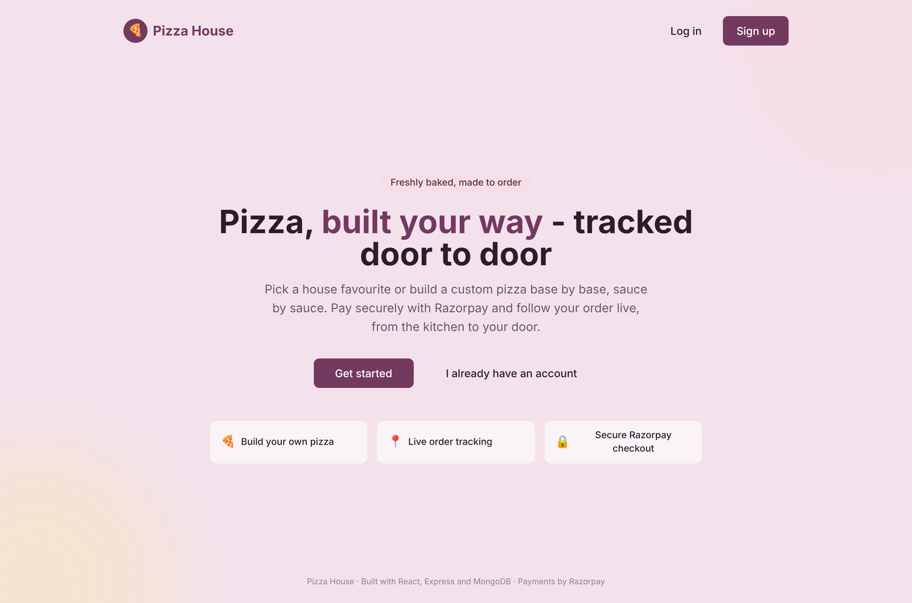
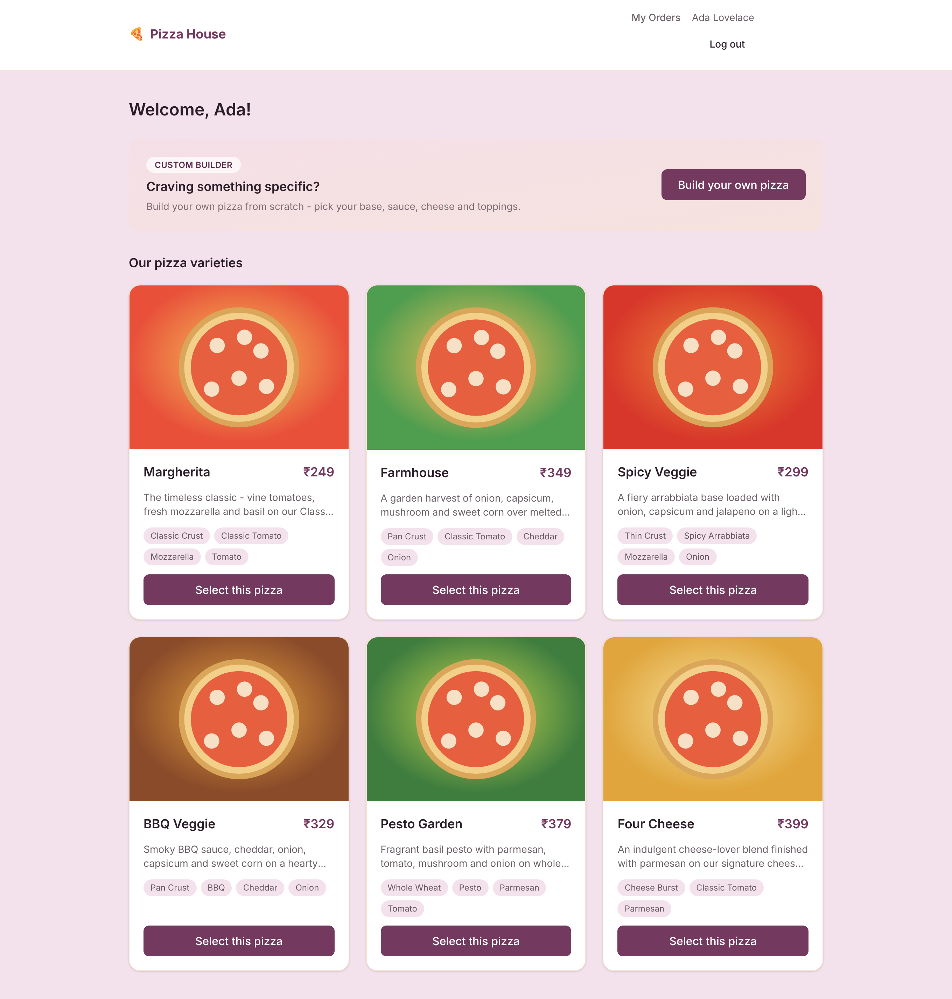
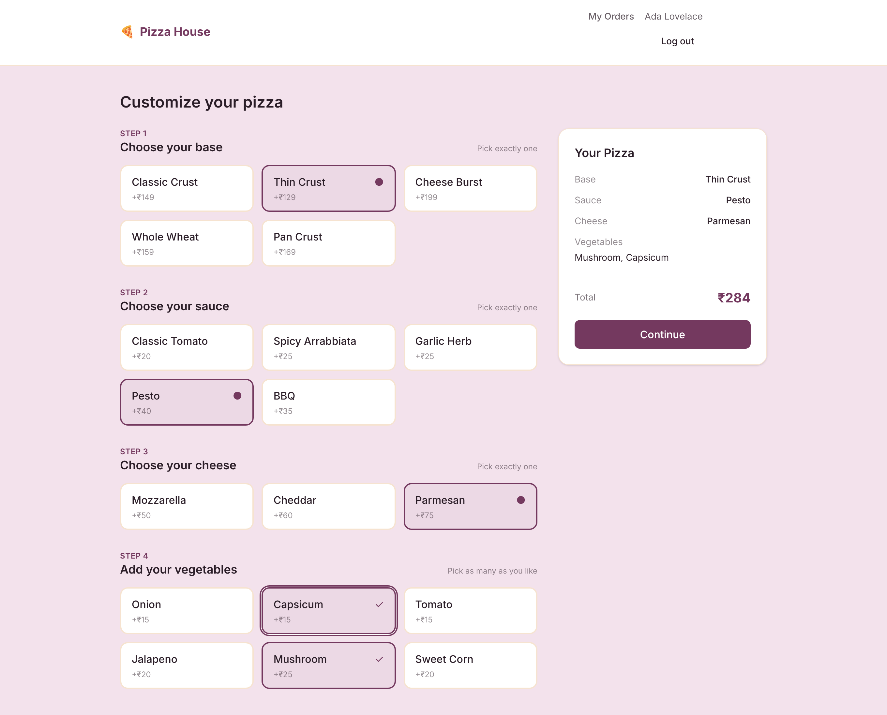
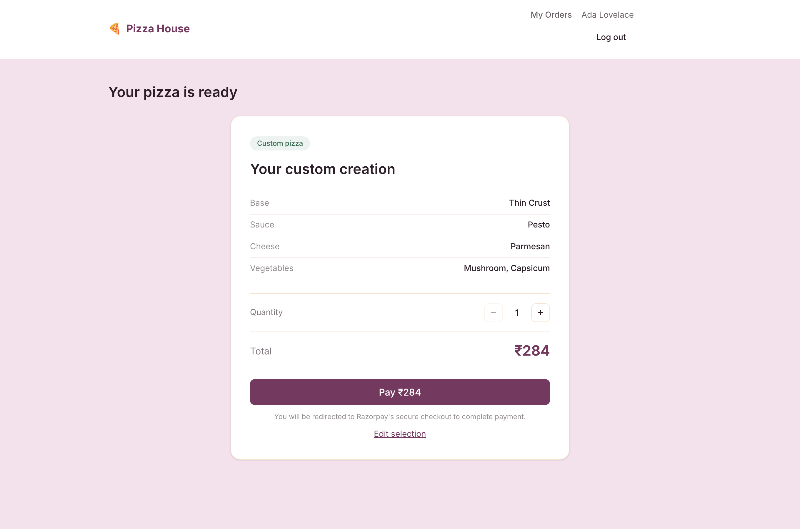
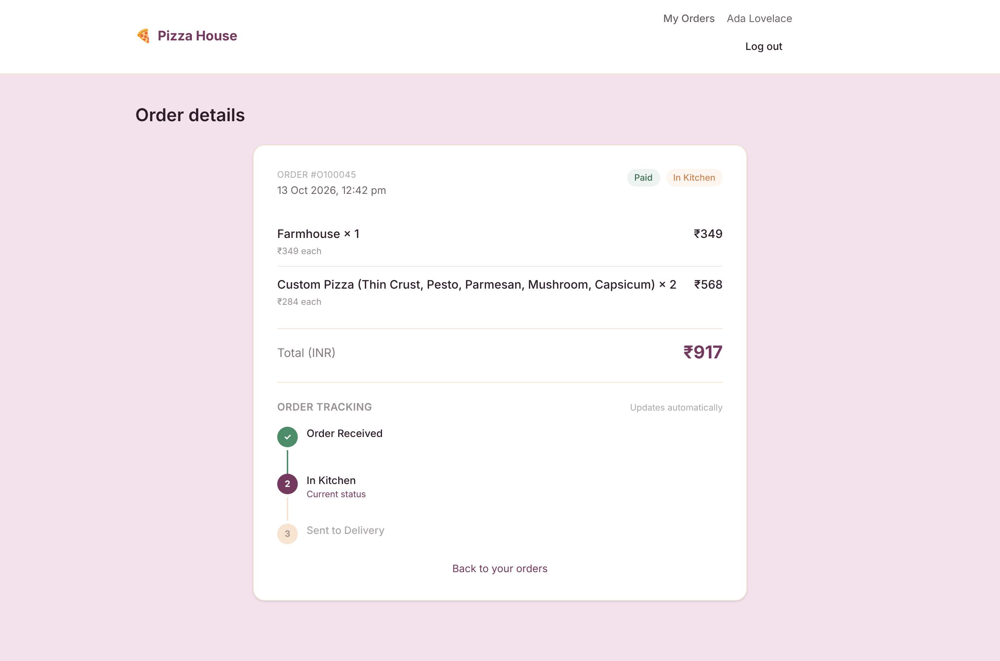
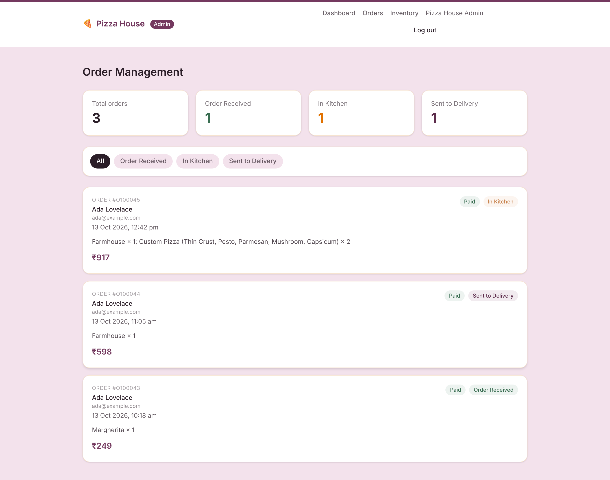
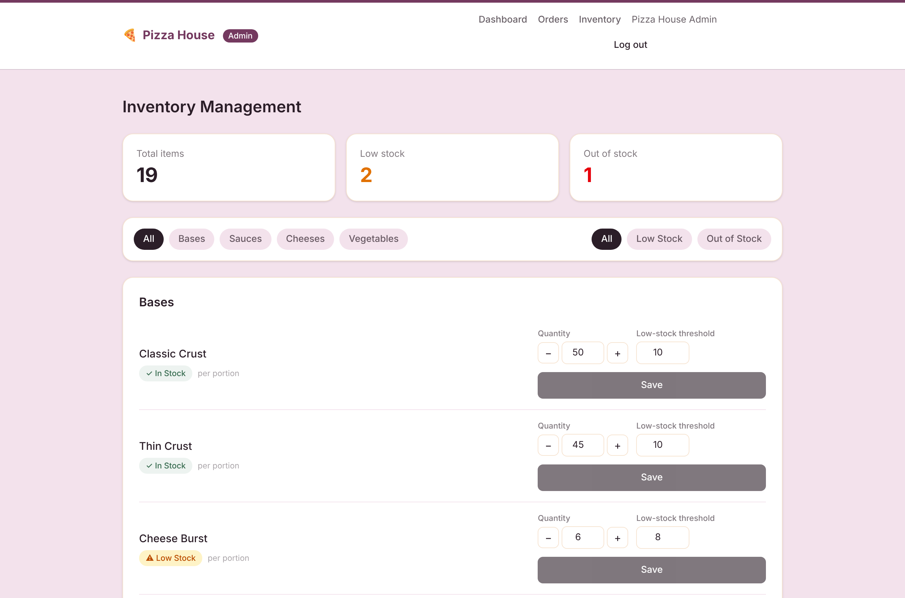

# Pizza House

A full-stack pizza ordering platform: build a pizza ingredient by ingredient,
pay through Razorpay, and watch the order move from the kitchen to the door —
with an admin side that keeps stock honest and emails itself when something runs
low.

[](../../actions/workflows/ci.yml)
[](LICENSE)
[](.nvmrc)



---

## Why this exists

Most ordering demos stop at "cart works, payment succeeds". The interesting
problems start just after that: who decides what a pizza costs, what happens
when two orders want the last ball of mozzarella, what a customer sees while
their order sits in a kitchen, and what stops a replayed payment callback from
charging someone twice.

Pizza House is built around those questions. The client is treated as an
untrusted caller throughout — every price, every payment outcome and every
status transition is decided on the server.

## Features

### Order a pizza, or design one

Pick a house favourite, or walk the four-step builder — one base, one sauce, one
cheese, as many vegetables as you like — with the price updating as you go. The
displayed price comes from the server (`POST /api/builder/validate`), so what you
see is what you are charged.




### Pay, and know it stuck

Checkout creates a Razorpay order in INR and verifies the signature **server-side**
before anything is marked paid. Verification is idempotent — a replayed callback
cannot pay an order twice or deduct stock twice.



### Follow the order

Once paid, the order detail page tracks the three kitchen stages and updates
itself every five seconds — no refresh, no manual check. Polling stops on its own
at `Sent to Delivery`, and a failed poll keeps the last known status on screen
rather than throwing an error at the customer.



### Run the kitchen

Admins advance orders one stage at a time — the backend rejects anything else,
including a crafted request that tries to skip a stage — and every transition is
recorded with the admin who made it.



### Keep stock honest

Paying for an order deducts its ingredients atomically. Concurrent orders cannot
drive stock negative, and if an ingredient turns out to be short, the deductions
already applied are rolled back and the order is flagged rather than silently
lost. Two admins editing the same item get a conflict, not a lost update.



A scheduled job checks every ingredient against its threshold independently of
any request and emails a single consolidated alert when something newly runs low
— then stays quiet about it until the item is restocked.

## Tech stack

| Layer      | Choice                                                   |
| ---------- | -------------------------------------------------------- |
| Frontend   | React 19, Vite, React Router, Tailwind CSS, Axios        |
| Backend    | Node.js, Express 5, MongoDB, Mongoose                    |
| Auth       | JWT in an httpOnly cookie, bcrypt password hashing       |
| Payments   | Razorpay (test mode), INR                                |
| Email      | Resend — verification, password reset, low-stock alerts  |
| Scheduling | node-cron                                                |
| Testing    | Vitest, Supertest, React Testing Library — 169 tests     |
| Tooling    | npm workspaces, ESLint, Prettier, GitHub Actions, Docker |

## Quick start

### With Docker

```bash
cp server/.env.example server/.env   # set JWT_SECRET and the ADMIN_* block
docker compose up --build
docker compose exec api npm run seed
```

The app is then on <http://localhost:8080>.

### Without Docker

Requires Node 20+ and a MongoDB connection string (local `mongod` or Atlas).

```bash
npm install                          # installs both workspaces
cp server/.env.example server/.env   # set MONGO_URI, JWT_SECRET, ADMIN_*
cp client/.env.example client/.env   # defaults are fine for local work

npm run seed                         # catalogue, inventory and the admin account
npm run dev                          # API on :5000, web client on :5173
```

Razorpay and Resend are optional in development: without Razorpay keys the
payment endpoints return a clear `503` instead of a broken checkout, and without
a Resend key emails are printed to the console instead of sent.

### The scripts

| Command          | What it does                             |
| ---------------- | ---------------------------------------- |
| `npm run dev`    | API and web client together, with reload |
| `npm test`       | Both test suites                         |
| `npm run lint`   | ESLint across both workspaces            |
| `npm run format` | Prettier, in place                       |
| `npm run build`  | Production build of the web client       |
| `npm run seed`   | Catalogue, inventory and admin account   |

Demo-reset helpers (local only, never pointed at production) live in
`server/seed/`: `seed:inventory:reset` restocks everything,
`seed:reset:orders` clears order history, and `seed:reset:users` removes every
non-admin account.

## Configuration

Every variable is documented in `server/.env.example` and `client/.env.example`.
The ones without a safe default:

| Variable                         | Why it matters                                       |
| -------------------------------- | ---------------------------------------------------- |
| `MONGO_URI`                      | Database connection string                           |
| `JWT_SECRET`                     | Signs session cookies — long and random              |
| `CLIENT_URL`                     | CORS origin, and the base for links inside emails    |
| `ADMIN_EMAIL` / `ADMIN_PASSWORD` | The seeded admin account; also where alerts are sent |
| `RAZORPAY_KEY_ID` / `_SECRET`    | Test-mode payment keys                               |
| `RESEND_API_KEY` / `EMAIL_FROM`  | Transactional email                                  |
| `LOW_STOCK_CRON_SCHEDULE`        | Defaults to every 15 minutes; `* * * * *` for a demo |

No secrets are committed to this repository.

## Testing

```bash
npm test             # 108 API tests + 61 web client tests
npm run test:server
npm run test:client
```

The API suite covers the pricing authority, payment-verification idempotency,
inventory deduction and rollback, the status state machine, auth middleware,
token hashing and the money conversions. The client suite covers the route
guards, the polling hook's lifecycle, and the formatting and validation helpers.
CI runs both on Node 20 and 22, along with lint, format check and a production
build.

## Project structure

```
.
├── client/              React + Vite web client
│   └── src/
│       ├── components/  Reusable UI and the route guards
│       ├── pages/       One component per route
│       ├── hooks/       Session, polling, Razorpay checkout
│       ├── services/    One module per API resource
│       └── tests/       Vitest + Testing Library
├── server/              Express API
│   ├── routes/          One router per resource
│   ├── controllers/     Request in, response out
│   ├── services/        Business rules and database writes
│   ├── models/          Mongoose schemas and indexes
│   ├── jobs/            The low-stock scheduler
│   ├── seed/            Catalogue, inventory, admin, demo resets
│   └── tests/           Vitest + Supertest
└── docs/                API reference, architecture notes, screenshots
```

Full details: **[docs/ARCHITECTURE.md](docs/ARCHITECTURE.md)** for how the pieces
fit and why, **[docs/API.md](docs/API.md)** for every endpoint.

## Deployment

Two services and a database:

- **Web client** — any static host. `npm run build`, publish `client/dist`, and
  set `VITE_API_URL` to the deployed API's `/api` URL at build time.
- **API** — any Node host running `npm start`. Set every variable from
  `server/.env.example`, with `NODE_ENV=production` (which also switches the
  session cookie to `Secure` + `SameSite=None`, required for a cross-origin
  frontend) and `CLIENT_URL` pointing at the deployed web client.
- **Database** — MongoDB Atlas or any reachable instance; run the seeds once
  against it.

Nothing hardcodes `localhost`: hosts, origins and credentials are all
environment-driven, so the same code runs locally and deployed.

## License

MIT — see [LICENSE](LICENSE).
